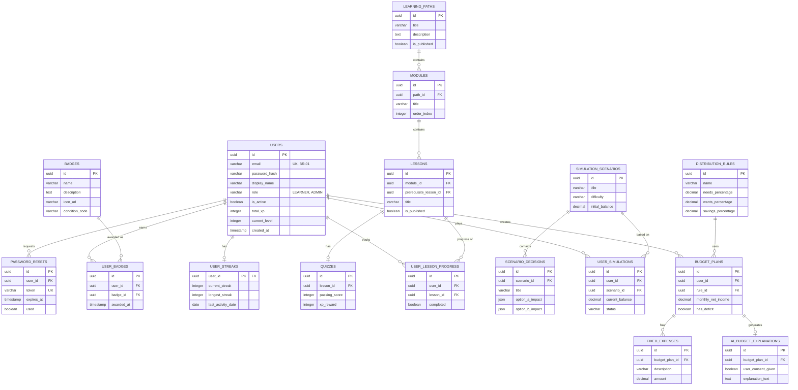

# 💸 FinLearn - Educación Financiera Gamificada

## 📖 Descripción del proyecto
FinLearn es una aplicación web para aprender finanzas personales mediante lecciones breves, ejercicios y decisiones simuladas. Nace con el propósito de resolver la falta de educación financiera básica en Colombia, un problema que afecta a gran parte de la población (solo el 16% domina conceptos básicos) y genera sobreendeudamiento y malas decisiones económicas. 

A diferencia de las herramientas tradicionales de presupuesto, FinLearn combina la educación teórica inspirada en microlecciones con una herramienta práctica de distribución de ingresos mensuales, y mecánicas de gamificación orientadas a reforzar hábitos financieros reales. Cabe resaltar que el sistema maneja simulaciones educativas y no se conecta a cuentas bancarias reales ni mueve dinero.

## ✨ Funcionalidades principales
* **Rutas de aprendizaje por niveles:** Ofrece módulos cortos sobre temas como ahorro, deuda, presupuesto, productos financieros e interés compuesto.
* **Microlecciones y cuestionarios:** Incluye ejercicios interactivos de opción múltiple que obligan al usuario a seleccionar una respuesta, evaluando y entregando retroalimentación inmediata con explicaciones.
* **Simulador de distribución de ingresos:** Permite al aprendiz ingresar su ingreso neto mensual y gastos fijos para calcular un plan según reglas seleccionables (como la regla 50/30/20). El sistema rechaza valores negativos y explica los errores de entrada.
* **Visualización y alertas de viabilidad:** Muestra los montos y porcentajes del plan en cifras y gráficas. Si los gastos fijos superan el ingreso mensual, el sistema activa una alerta de inviabilidad y evita presentar el plan como equilibrado.
* **Escenarios de decisiones:** Presenta cartas con escenarios cotidianos donde el usuario elige entre distintas opciones para avanzar en un ciclo mensual de 30 días.
* **Barras de estado dinámicas:** Las decisiones en el simulador afectan inmediatamente cinco barras de estado: Ingresos, Gastos, Ahorros, Inversión y Diversión. Al finalizar el mes, el sistema evalúa si hubo éxito o un "desastre financiero" que obligue a reiniciar el ciclo.
* **Sistema de Gamificación:** Otorga experiencia (XP) por lecciones completadas, calcula rachas diarias de actividad y asigna niveles e insignias de acuerdo con el progreso, asegurando no otorgar la misma recompensa dos veces.

## 👥 Actores del sistema
* **Usuario aprendiz:** Persona que interactúa con la plataforma para tomar lecciones, acumular experiencia (XP) y construir su plan de ingresos simulado.
* **Administrador del sistema:** Encargado de gestionar las cuentas de usuario y administrar todo el contenido educativo y de simulación, sin tener acceso a las contraseñas originales de los usuarios.
* **Visitante:** Persona sin cuenta registrada que puede explorar la propuesta de valor y crear una cuenta nueva.

## 🧮 Diagrama de clases 

```mermaid
classDiagram

%% ==========================================
%% CORE (Centro)
%% ==========================================

    class User {
        +UUID id
        +String email
        -String password_hash
        +String display_name
        +String role
        +Boolean is_active
        +Integer total_xp
        +Integer current_level
        +Date created_at
        +login(email, password) Boolean
        +updateProfile(data)
        +deactivateAccount()
    }


%% ==========================================
%% 1. RAMA AUTH Y GAMIFICACIÓN
%% ==========================================
namespace Auth_and_Gamification {
    class PasswordReset {
        +UUID id
        +UUID user_id
        +String token
        +Date expires_at
        +Boolean used
        +generateToken()
        +validateToken() Boolean
    }

    class Badge {
        +UUID id
        +String name
        +String description
        +String icon_url
        +String condition_code
        +checkCondition(User) Boolean
    }

    class UserBadge {
        +UUID id
        +UUID user_id
        +UUID badge_id
        +Date awarded_at
        +awardBadge()
    }

    class UserStreak {
        +UUID user_id
        +Integer current_streak
        +Integer longest_streak
        +Date last_activity_date
        +updateStreak()
        +resetStreakIfBroken()
    }
}

%% ==========================================
%% 2. RAMA EDUCACIÓN Y EVALUACIONES
%% ==========================================
namespace Learning_and_Assessments {
    class LearningPath {
        +UUID id
        +String title
        +Boolean is_published
        +publish()
    }

    class Module {
        +UUID id
        +String title
        +Integer order_index
    }

    class Lesson {
        +UUID id
        +String title
        +String content
        +Boolean is_published
        +unlockIfPrerequisiteMet(User) Boolean
    }

    class Quiz {
        +UUID id
        +String title
        +Integer passing_score
        +Integer xp_reward
        +evaluateAnswers(List) Integer
    }

    class Question {
        +UUID id
        +String question_text
        +String explanation
        +getExplanation() String
    }

    class AnswerOption {
        +UUID id
        +String option_text
        +Boolean is_correct
    }

    class UserLessonProgress {
        +UUID id
        +Boolean completed
        +Date completed_at
        +markAsCompleted()
        +assignXP()
    }

    class QuizAttempt {
        +UUID id
        +Integer score
        +Boolean passed
        +Date attempted_at
        +calculateFinalScore()
    }
}

%% ==========================================
%% 3. RAMA SIMULACIÓN FINANCIERA
%% ==========================================
namespace Financial_Simulation {
    class SimulationScenario {
        +UUID id
        +String title
        +String difficulty
        +Float initial_balance
        +Boolean is_published
        +startNewGame(User) UserSimulation
    }

    class ScenarioDecision {
        +UUID id
        +Integer day_number
        +String title
        +JSON option_a_impact_json
        +JSON option_b_impact_json
        +applyImpact(String option) Map
    }

    class UserSimulation {
        +UUID id
        +Integer current_day
        +Float current_balance
        +String status
        +Float final_score
        +processDecision(ScenarioDecision, String)
        +checkDisasterStatus() Boolean
        +finishMonth() Float
    }

    class SimulationLog {
        +UUID id
        +String chosen_option
        +Float balance_after
        +recordAction()
    }
}

%% ==========================================
%% 4. RAMA PRESUPUESTOS Y AI
%% ==========================================
namespace Budget_and_AI {
    class DistributionRule {
        +UUID id
        +String name
        +Float needs_percentage
        +Float wants_percentage
        +Float savings_percentage
        +validate100Percent() Boolean
    }

    class BudgetPlan {
        +UUID id
        +String title
        +Float monthly_net_income_cop
        +Float savings_goal_cop
        +Boolean has_deficit
        +calculateDistribution()
        +validatePositiveValues() Boolean
        +checkDeficit() Boolean
    }

    class ExpenseCategory {
        +UUID id
        +String name
        +String type
    }

    class FixedExpense {
        +UUID id
        +String description
        +Float amount_cop
        +deductFromCategory()
    }

    class AIBudgetExplanation {
        +UUID id
        +Boolean user_consent_given
        +String explanation_text
        +Boolean is_fallback
        +requestExplanation(BudgetPlan) String
        +handleTimeoutFallback() String
    }
}

%% ==========================================
%% RELACIONES 
%% ==========================================

%% 1. RAMA GAMIFICACIÓN Y AUTH 
UserStreak "0..1" <-- "1" User : has
PasswordReset "*" <-- "1" User : requests
UserBadge "*" <-- "1" User : unlocks
Badge "1" <-- "*" UserBadge : references

%% 2. RAMA PRESUPUESTOS
BudgetPlan "*" <-- "1" User : creates
FixedExpense "*" --* "1" BudgetPlan : has
ExpenseCategory "1" <-- "*" FixedExpense : categorized as
DistributionRule "1" <-- "*" BudgetPlan : uses
AIBudgetExplanation "0..1" <-- "1" BudgetPlan : generates

%% 3. RAMA SIMULACIÓN
UserSimulation "*" <-- "1" User : plays
SimulationLog "*" --* "1" UserSimulation : records
SimulationScenario "1" <-- "*" UserSimulation : based on
ScenarioDecision "*" --* "1" SimulationScenario : contains
ScenarioDecision "1" <-- "*" SimulationLog : answers

%% 4. RAMA EDUCACIÓN
UserLessonProgress "*" <-- "1" User : tracks
QuizAttempt "*" <-- "1" User : makes
Lesson "1" <-- "*" UserLessonProgress : progress of
Quiz "1" <-- "*" QuizAttempt : attempts on
Module "1" <-- "*" Lesson : belongs to
LearningPath "1" <-- "*" Module : belongs to
Quiz "0..1" <-- "1" Lesson : has
Question "*" --* "1" Quiz : contains
AnswerOption "*" --* "1" Question : contains
Lesson "0..1" <-- "1" Lesson : prerequisite

%% Notas de Reglas de Negocio
note for DistributionRule "BR-16: Suma debe ser 100%"
note for BudgetPlan "BR-14: Sin negativos\nBR-19: Déficit si > ingreso"
note for AIBudgetExplanation "BR-37: Consentimiento explícito\nBR-40: Fallback > 10s"
note for UserSimulation "BR-29: IN_PROGRESS, COMPLETED, DISASTER"

```

##  🧮 Diagrama Base de datos 

## 🛠️ Tecnologías y Arquitectura
* **Frontend:** React (Vite) junto con Tailwind CSS. Se garantiza la accesibilidad permitiendo que el registro, estudio y elaboración de presupuestos puedan completarse utilizando únicamente el teclado.
* **Backend:** Node.js con el framework Express para el desarrollo de la API REST encargada de la lógica de la plataforma.
* **Base de datos:** PostgreSQL para el almacenamiento relacional de los usuarios, progreso y simulaciones. Se garantiza la integridad de los presupuestos mediante transacciones, evitando guardados parciales.
* **Autenticación y Seguridad:** Se implementa JWT con manejo de roles en el servidor. Todas las comunicaciones utilizan HTTPS y las contraseñas se almacenan mediante hashes seguros.
* **Despliegue:** Alojamiento en Railway para backend, base de datos y frontend.

## 🚀 Roadmap de Lanzamientos (Releases)
El desarrollo del proyecto está estructurado en tres fases principales:
1. **Release 1 - Aprender y planificar (MVP):** Contempla el registro de cuentas, navegación de rutas teóricas, cuestionarios y la creación del plan de presupuesto base.
2. **Release 2 - Motivar y administrar:** Introduce el panel de identidad del perfil, métricas de retención (XP, rachas, insignias) y el panel completo de gestión de contenidos para los administradores.
3. **Release 3 - Simular y explicar con IA:** Implementación del mazo de decisiones complejas, las barras de estado dinámicas, evaluación de fin de mes y la integración con Inteligencia Artificial externa.

## 👨‍💻 Equipo de Desarrollo (Ingeniería de Software 2)
Proyecto desarrollado por estudiantes de Ingeniería de Sistemas y Computación de la Universidad Nacional de Colombia (Bogotá D.C.):
* Arnold Oswaldo Acosta Ortega
* Omar Alejandro Salazar Carvajal
* Juan David Peña Lozada
* Luis Rodrigo Rivera Rivera
* Nicolas David Moreno Villanueva
